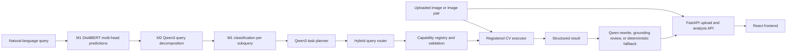

# SatQuery AI

**Natural-language satellite image analysis with local NLP models and task-specific computer vision.**

SatQuery AI lets a user upload satellite imagery, ask a question in ordinary language, and inspect the structured output from a registered computer-vision capability. The application combines a local DistilBERT multi-head classifier, Qwen3 through Ollama, task planning and routing, a FastAPI service, and a React interface.

> **Evaluation note:** The repository contains local datasets, model checkpoints, and generated outputs that are excluded from Git. A fresh clone needs those artifacts supplied separately before all model-backed capabilities can run. The reported sample outputs below are smoke-test examples, not benchmark accuracy measurements.

## Problem and objectives

Remote-sensing workflows often require users to select a model and translate a question into a task-specific operation. SatQuery AI explores a single interface for that process. Its objectives are to interpret supported natural-language requests, route supported requests to registered CV executors, return structured evidence-based results, and present detections, pixel summaries, and overlays in a browser.

## Features

- Upload supported JPEG, PNG, WebP, and TIFF files through the backend.
- Submit image questions through the chat-style analysis flow.
- Route building, land-cover, building-change, and flood requests to registered capabilities.
- Reuse compatible results for supported same-session follow-up questions.
- View building detections and analysis summaries; request change and flood overlays.
- Reject unavailable or unsupported tasks with a capability-validation response.

Flood analysis has a stricter input contract than the general upload endpoint: it requires a readable two-band SAR GeoTIFF at least 224 ? 224 pixels. Building-change analysis requires before and after images of matching dimensions.

## System architecture



See [System Architecture](docs/SYSTEM_ARCHITECTURE.md) for component boundaries and data flow.

## Technology stack

| Layer | Main technologies |
|---|---|
| NLP | PyTorch, Transformers, DistilBERT, local Ollama, Qwen3 |
| CV | PyTorch, torchvision, Ultralytics YOLO, Rasterio, Pillow, NumPy |
| Backend | FastAPI, Uvicorn, Pydantic |
| Frontend | React, Vite, JavaScript, Node.js |
| Tests | pytest, Node.js built-in test runner |

Python package pins are in [`requirements.txt`](requirements.txt); frontend scripts and dependencies are in [`frontend/package.json`](frontend/package.json) and [`frontend/package-lock.json`](frontend/package-lock.json).

## NLP pipeline

M1 loads the local DistilBERT tokenizer and fine-tuned checkpoint from `models/m1_distilbert/final_6_intent_balanced/`. Its seven configured heads predict intent, target, attribute, ambiguity, spatial relation, reference, and region. The base encoder is loaded with `local_files_only=True`, so compatible base-model files must already be available in the local Transformers cache.

M2 uses `qwen3:1.7b` through Ollama to rewrite a query into standalone subqueries. The task planner uses Qwen3 again to produce structured operations and targets. M1 classifies each subquery; the hybrid router normalizes tasks to canonical capability names, and the capability registry checks that the implementation and required artifacts exist before execution. The response generator asks Qwen3 to rephrase a deterministic result summary, then asks it to check factual equivalence; errors or rejected rewrites use the deterministic summary.

More detail is in [NLP Pipeline](docs/NLP_PIPELINE.md).

## Computer-vision capabilities

| Dataset / task | Implementation | Current result contract |
|---|---|---|
| SpaceNet2 building detection | YOLO26n wrapper in `cv/models/building.py` | Building count, box coordinates, confidence, and centers |
| LoveDA land-cover segmentation | MobileNetV3 Small U-Net in `cv/models/land_cover.py` | Seven-class mask and class pixel counts; derived vegetation statistics are image-pixel values |
| LEVIR-CD building change | SiameseAttentionChangeNet in `cv/models/change_v2.py` | Changed-pixel count and fraction at model resolution; optional overlay |
| Sen1Floods11 flood detection | Radiance Sen1Floods11 v2 executor in `cv/models/flood.py` | Flood, valid, and invalid pixel counts; optional flood overlay |

These are task implementations, not accuracy claims. Physical area is not computed by the land-cover or flood response paths. Read [CV Models](docs/CV_MODELS.md) for input conditions, artifact paths, and dataset citations.

## Repository map

| Path | Purpose |
|---|---|
| `backend/` | FastAPI application, route modules, upload and inference services |
| `nlp/` | M1 loader, Ollama/Qwen client, task planner, router, and orchestration pipeline |
| `integration/` | Conversational response generation and supporting integration modules |
| `cv/models/` | Building, land-cover, change, and flood executors |
| `cv/registry.py` | Registration of available model-backed CV capabilities |
| `cv/configs/`, `cv/preprocessing/` | Dataset/model configuration and preprocessing utilities |
| `frontend/` | React/Vite application, API services, UI components, and Node tests |
| `tests/` | Python routing, integration, and CV contract tests |
| `data/`, `models/`, `runs/`, `cv/outputs/` | Local data, checkpoints, and generated artifacts; excluded from normal Git tracking |
| `docs/` | Project, architecture, API, setup, test, and limitation documentation |
| `assets/screenshots/` | Reserved for genuine, manually captured application screenshots |

Historical handoff snapshots and audit artifacts are present in the working tree. They are not runtime components and are intentionally excluded from the proposed initial documentation staging list.

## Installation and local setup

The pinned backend dependencies were used in a local Python 3.14 CPU environment. The Vite lockfile requires Node.js `^20.19.0` or `>=22.12.0`. Ollama and Qwen3 are external runtime requirements, not Python packages.

1. Create a Python environment and install the pinned backend dependencies:

   ```powershell
   py -3.14 -m venv .venv
   .\.venv\Scripts\Activate.ps1
   python -m pip install --upgrade pip
   pip install -r requirements.txt
   ```

2. Install frontend dependencies from its lockfile:

   ```powershell
   cd frontend
   npm ci
   cd ..
   ```

3. Start the already-installed Ollama service and confirm `ollama list` includes `qwen3:1.7b`. The client uses `http://localhost:11434` by default. Model installation/download is a separate provisioning step.
4. Ensure the local model files and checkpoints listed in [Installation](docs/INSTALLATION.md) are available. They are not distributed by this Git repository.

### Start the backend

From the repository root in PowerShell:

```powershell
.\.venv\Scripts\python.exe -m uvicorn backend.main:app --host 127.0.0.1 --port 8000
```

### Start the frontend

In a second PowerShell terminal:

```powershell
cd frontend
npm.cmd run dev -- --host 127.0.0.1 --port 5173
```

The frontend defaults to `http://localhost:8000` for its API. See [Installation](docs/INSTALLATION.md) for runtime prerequisites and the model-artifact checklist.

## API overview

The backend exposes health, upload, analysis, conversational query, history, result-detail, and overlay routes. The browser flow uploads an image using `/api/images/upload`, then submits the returned `image_id` to `/api/query`. See [API Documentation](docs/API_DOCUMENTATION.md) for request fields and behavior.

| Method | Route | Purpose |
|---|---|---|
| `GET` | `/api/health` | Backend health response |
| `POST` | `/api/images/upload` | Upload one supported image and receive an image ID |
| `POST` | `/api/query` | Query an uploaded image, optionally with a second image and session ID |
| `POST` | `/api/analysis` | Submit the analysis request contract directly |
| `GET` | `/api/analysis/history` | List in-memory analysis summaries |
| `GET` | `/api/analysis/{analysis_id}` | Return an in-memory analysis result |
| `GET` | `/api/analysis/{analysis_id}/change-overlay` | Return a saved change overlay when available |
| `GET` | `/api/analysis/{analysis_id}/flood-overlay` | Return a saved flood overlay when available |

## Example natural-language queries

- ?How many buildings are visible??
- ?Where are the buildings??
- ?What land-cover classes are present??
- ?What percentage of this image is vegetation??
- ?Compare these before and after images for building changes.?
- ?Identify flooded regions in this SAR image.?

Supported operations depend on capability availability and input type. Geographic land-cover area is unsupported; segmentation returns pixel counts rather than georeferenced area.

## Testing and sample outputs

The current recorded automated verification is **69 Python tests passed, 1 skipped**, and **17 frontend tests passed**. These are test-suite results, not benchmark metrics. See [Testing Report](docs/TESTING_REPORT.md).

Prior local demo history records these sample smoke outputs: 19 building detections; LoveDA forest 121,424 pixels and agriculture 372,656 pixels; LEVIR-CD 126 changed pixels at 256 ? 256 model resolution; and Sen1Floods11 48,893 flood pixels among 101,623 valid pixels. These values are tied to particular sample inputs and checkpoints, are not accuracy or benchmark results, and were not rerun during this documentation pass.

## Screenshots and demo

No genuine full-application screenshots were found. `frontend/src/assets/hero.png` is a decorative graphic, while satellite inputs and CV overlays are not application screenshots. See [`assets/screenshots/README.md`](assets/screenshots/README.md) for suggested manual captures.

## Limitations and future work

- Model weights, datasets, M1 files, and generated outputs are local-only and ignored by Git.
- Conversation sessions and analysis records are process-local and do not survive backend restart.
- Qwen's semantic review is model-based, not a formal guarantee.
- Current outputs are pixel/model-resolution measurements, not geospatial area estimates.
- Checks are smoke tests and code-contract tests, not full-dataset evaluations.
- The local API has no authentication layer; a public deployment needs separate access-control and persistence work.

Potential next steps include an approved artifact manifest, full-dataset evaluation protocols, durable storage and authentication for deployment, and genuine UI screenshots. See [Limitations](docs/LIMITATIONS.md).

## Dataset credits and citations

- SpaceNet2: Van Etten, A., Lindenbaum, D., and Bacastow, T. M. ?SpaceNet: A Remote Sensing Dataset and Challenge Series.? 2018. [Paper](https://arxiv.org/abs/1807.01232); [SpaceNet2 dataset page](https://spacenet.ai/spacenet-buildings-dataset-v2/).
- LoveDA: Wang, J., Zheng, Z., Ma, A., Lu, X., and Zhong, Y. ?LoveDA: A Remote Sensing Land-Cover Dataset for Domain Adaptive Semantic Segmentation.? NeurIPS Datasets and Benchmarks, 2021. [Paper](https://arxiv.org/abs/2110.08733); [dataset DOI](https://doi.org/10.5281/zenodo.5706578).
- LEVIR-CD: Chen, H. and Shi, Z. ?A Spatial-Temporal Attention-Based Method and a New Dataset for Remote Sensing Image Change Detection.? *Remote Sensing*, 12(10), 1662, 2020. [Paper and DOI](https://doi.org/10.3390/rs12101662); [dataset page and terms](https://justchenhao.github.io/LEVIR/).
- Sen1Floods11: Bonafilia, D., Tellman, B., Anderson, T., and Issenberg, E. ?Sen1Floods11: A Georeferenced Dataset to Train and Test Deep Learning Flood Algorithms for Sentinel-1.? CVPR Workshops, 2020. [Paper](https://openaccess.thecvf.com/content_CVPRW_2020/html/w11/Bonafilia_Sen1Floods11_A_Georeferenced_Dataset_to_Train_and_Test_Deep_Learning_CVPRW_2020_paper.html); [dataset repository and citation guidance](https://github.com/cloudtostreet/Sen1Floods11).

Consult dataset-owner pages for current license and usage terms. No dataset contents or model weights are included here.
