# LISAt: Language-Instructed Segmentation Assistant for Satellite Imagery

**Quenum et al., 2025 (NeurIPS)** introduce **LISAt**, a vision-language foundation model for **geospatial reasoning segmentation**[LISAt paper](https://arxiv.org/abs/2505.02829)[LISAt paper](https://arxiv.org/abs/2505.02829). Unlike standard segmentation models that only recognize pre-defined classes, LISAt is trained to answer *natural-language queries* about satellite images and produce both textual answers and **pixel-wise segmentation masks** for objects or regions of interest[LISAt paper](https://arxiv.org/abs/2505.02829)[LISAt paper](https://arxiv.org/abs/2505.02829). This addresses the problem that existing models (even recent vision-language models) struggle with complex, open-ended queries on **remote-sensing** images, which are visually challenging (high clutter, scale variation, small objects) and lack annotated query-data[LISAt paper](https://arxiv.org/abs/2505.02829)[LISAt paper](https://arxiv.org/abs/2505.02829). For example, queries like *“Identify flood-prone urban areas”* or *“Which regions have observed urban expansion?”* require contextual understanding beyond fixed categories[LISAt paper](https://arxiv.org/abs/2505.02829). LISAt fills this gap by combining image and language understanding specifically for satellite imagery.

## 1. Background and Problem Statement  
Remote-sensing semantic segmentation is critical for applications (disaster response, environmental monitoring, urban planning) but traditionally covers only *fixed tasks* (e.g. building masks)[LISAt paper](https://arxiv.org/abs/2505.02829). In practice, analysts need **flexible, context-dependent** segmentations (reasoning segmentation) based on user-defined queries. For example, locating *“roads damaged by flooding”* requires linking the concept of flooding with road geometry in the image. However, *“reasoning segmentation”* for satellite images is underexplored[LISAt paper](https://arxiv.org/abs/2505.02829)[LISAt paper](https://arxiv.org/abs/2505.02829). Directly applying natural-image VLMs fails because satellite images have unique challenges: extreme scale variation (from entire cities to single cars), objects that look visually similar (car vs. building), and very limited paired image–natural-language datasets[LISAt paper](https://arxiv.org/abs/2505.02829). In essence, while vision-language models can caption or answer VQA on remote images (RS-GPT4V, EarthGPT, etc.), they **do not** produce segmentation masks and perform poorly on fine-grained spatial tasks[LISAt paper](https://arxiv.org/abs/2505.02829)[LISAt paper](https://arxiv.org/abs/2505.02829). 

**Problem:** *How to build a model that can understand satellite imagery and a user’s natural-language query, and output the requested segmentation mask (plus any textual answer)?* 

## 2. Motivation and Objectives  
LISAt is motivated by the need for **open-domain segmentation** in remote sensing – i.e., letting users ask arbitrary questions and get precise pixel-level answers. The main objective is to design a **multimodal AI assistant** that can jointly reason about text and satellite images. Specifically, LISAt aims to:

- **Understand complex queries** about geospatial images (not limited to fixed categories).  
- **Generate pixel-wise segmentation masks** corresponding to the query (e.g. “segment all flood-prone areas”).  
- **Provide textual descriptions or answers** about the image if needed.  
- **Leverage large vision and language models** while addressing remote-sensing specifics (scale, data scarcity).  

To achieve this, the researchers built new datasets (GRES and PreGRES) and a combined vision-language model that can output both text and segmentation[LISAt paper](https://arxiv.org/abs/2505.02829)[LISAt paper](https://arxiv.org/abs/2505.02829).

## 3. Key Contributions  
The paper’s main contributions are: 

- **LISAt model:** A new open-source vision-language model designed for satellite-image reasoning segmentation[LISAt paper](https://arxiv.org/abs/2505.02829). It extends LLaVA-style multimodal LLMs by adding a segmentation-decoder branch.  
- **GRES dataset:** A large synthetic/geocoded dataset of satellite images paired with human-like queries and pixel masks (27,615 queries over 9,205 images)[LISAt paper](https://arxiv.org/abs/2505.02829)[LISAt paper](https://arxiv.org/abs/2505.02829). Each sample has an image, a natural-language query (referring to one object), and the ground-truth mask.  
- **PreGRES dataset:** A pre-training corpus combining many existing geospatial image-caption and image–QA datasets (e.g. NWPU-Captions, RSICD, FloodNet, etc.), totaling ~119k images and 1.2M Q&A pairs[LISAt paper](https://arxiv.org/abs/2505.02829). This is used to imbue the model with general remote-sensing knowledge.  
- **Performance gains:** LISAt significantly outperforms prior models. On visual description tasks, it beats RS-GPT4V by +10.04% BLEU-4[LISAt paper](https://arxiv.org/abs/2505.02829), and on reasoning segmentation (GRES) it exceeds open-domain baselines by +143.36% in generalized IoU (gIoU)[LISAt paper](https://arxiv.org/abs/2505.02829)[LISAt paper](https://arxiv.org/abs/2505.02829). 

These contributions combine to push remote-sensing AI toward more flexible, user-driven image understanding. (See **project page** for code and data: [lisat-bair.github.io](https://lisat-bair.github.io/)[LISAt paper](https://arxiv.org/abs/2505.02829).)

## 4. Architecture Overview  
LISAt’s architecture merges a vision encoder, a language model, and a segmentation decoder[LISAt paper](https://arxiv.org/abs/2505.02829)[LISAt paper](https://arxiv.org/abs/2505.02829). The high-level components are:

- **Vision Encoder:** *RemoteCLIP (ViT-L/14)* – a CLIP-style transformer adapted to satellite imagery[LISAt paper](https://arxiv.org/abs/2505.02829). It converts the input RGB satellite image into visual feature tokens.  
- **Language Model:** *Vicuna-7B* – an open-source LLM that processes the user’s query[LISAt paper](https://arxiv.org/abs/2505.02829). The query (in natural language) is tokenized and embedded.  
- **Embedding Alignment:** A simple linear projection maps the visual features into the same dimension as the word embeddings, so that image information can be injected into the language model’s input[LISAt paper](https://arxiv.org/abs/2505.02829). This enables the LLM to “see” the image.  
- **Segmentation Decoder (SAM-based):** The popular SAM (“Segment Anything Model”) is used as a mask generator. The innovation is introducing a special token **`<SEG>`** into the language model. When LISAt’s LLM output includes `<SEG>`, the model routes the token’s final-layer embedding through a small MLP into SAM’s query space. Together with image features, SAM then predicts a pixel mask for the described object[LISAt paper](https://arxiv.org/abs/2505.02829).  
- **Training Head:** The model is trained end-to-end so that it learns when to emit `<SEG>` for segmentation and otherwise emit textual tokens (answers or descriptions). The total loss combines cross-entropy on the generated text and a mask loss (binary cross-entropy + Dice) on the predicted segmentation[LISAt paper](https://arxiv.org/abs/2505.02829).

In summary, as shown in Figure below, LISAt processes **(image + query)** through RemoteCLIP and Vicuna. The LLM decides whether to answer in text or produce a `<SEG>` token. If `<SEG>` appears, the corresponding embedding is fed to the SAM decoder to produce the segmentation mask. Otherwise, the model outputs text (captions, QA answers)[LISAt paper](https://arxiv.org/abs/2505.02829)[LISAt paper](https://arxiv.org/abs/2505.02829).

```
[Satellite Image] + [User Query] 
    ↓ (Vision) RemoteCLIP and (Language) Vicuna-7B merge 
    ↓ Language Model outputs tokens 
    ↳ If output contains "<SEG>" 
        → Project <SEG> embedding → SAM decoder → **Segmentation Mask** 
    ↳ Else 
        → Continue autoregressive text generation → **Text Answer/Caption**
``` 

*Architecture diagram:* LISAt integrates a pretrained RemoteCLIP+Vicuna VLM, pre-trained on geospatial data, and extends it with a `<SEG>` token whose embedding is used by a SAM-based decoder to output masks[LISAt paper](https://arxiv.org/abs/2505.02829)[LISAt paper](https://arxiv.org/abs/2505.02829).

## 5. Inference and Workflow  
At inference time, a user provides a satellite image and a natural-language instruction. The workflow is as follows:

1. **Encoding:** The image is passed through RemoteCLIP (ViT backbone) to get visual features. The query is tokenized and fed to Vicuna.  
2. **Multimodal Fusion:** The visual features (via linear projection) are injected into the Vicuna model, enabling cross-modal attention.  
3. **Token Prediction:** The LLM generates tokens one by one. If the instruction calls for segmentation, the model learns to generate the special token `<SEG>`.  
4. **Mask Generation:** Upon generating `<SEG>`, its last-layer embedding is taken and passed through a learned linear layer to become a SAM query. The SAM decoder then computes a high-resolution binary mask for the object or region specified by the query[LISAt paper](https://arxiv.org/abs/2505.02829).  
5. **Answer Output:** The model can continue to generate any additional textual output. The final output is a combination of the mask and the generated text (e.g. “Here is the segmented building” plus the mask image).

Because LISAt is trained on paired (query, mask) data (GRES), it learns to align phrases like *“the large rectangular building”* with the corresponding pixels. It also handles answering non-segmentation queries by simply outputting text. In essence, its inference behaves like a **textually-guided segmentation system for satellite images**[LISAt paper](https://arxiv.org/abs/2505.02829)[LISAt paper](https://arxiv.org/abs/2505.02829).

## 6. Training Methodology and Stages  
Training LISAt is done in two main stages with specific objectives:

- **Stage 1: Multimodal Pre-Training on PreGRES.** Using the large PreGRES corpus (with ~1.2M image–QA pairs), the model (Vicuna+RemoteCLIP) is fine-tuned with *LoRA* adapters for 1 epoch. The task is standard next-token prediction (no segmentation token used yet). This stage teaches the model general remote-sensing vision-language associations (captions, VQA)[LISAt paper](https://arxiv.org/abs/2505.02829)[LISAt paper](https://arxiv.org/abs/2505.02829).  
  - *Details:* Context length 2048, AdamW optimizer (LR=3e-4), batch size 2 (with gradient accumulation), training on 8 A100 GPUs[LISAt paper](https://arxiv.org/abs/2505.02829).

- **Stage 2: Fine-Tuning on GRES (and auxiliary sets).** Next, LISAt is fine-tuned on the GRES dataset of segmentation queries. During this stage, the `<SEG>` token is introduced. The model is trained to generate both textual output and segmentation masks. The training data also includes two natural-image referring-segmentation datasets (FP-Ref-COCO and ReasonSeg) to increase generality[LISAt paper](https://arxiv.org/abs/2505.02829). LoRA is kept on the language model, and the SAM decoder weights are fully trainable. The loss is a weighted sum of:
  - **Text loss (ℓ_txt):** Cross-entropy for language modeling.  
  - **Mask loss (ℓ_mask):** Combination of BCE and Dice losses on the predicted mask[LISAt paper](https://arxiv.org/abs/2505.02829). Empirically, equal weighting (λ_txt=λ_mask=1) with BCE and Dice components (both weight 1) worked well[LISAt paper](https://arxiv.org/abs/2505.02829).

The combined loss is:  $\mathcal{L} = \lambda_{txt}\,\text{CE}(\hat y_{txt},y_{txt}) + \lambda_{mask}(\text{BCE}(\hat M,M) + \text{Dice}(\hat M,M))$[LISAt paper](https://arxiv.org/abs/2505.02829).

Training continued for about 12 hours on 8 A100 GPUs (as reported)[LISAt paper](https://arxiv.org/abs/2505.02829). The two-stage approach (general VQA pre-training, then specific mask-fine-tuning) allows LISAt to first learn broad vision-language skills before focusing on segmentation queries.

## 7. Datasets: PreGRES and GRES  
**PreGRES (Pre-training for Geospatial Reasoning Segmentation):** A large amalgamation of public remote-sensing datasets covering image captions, VQA, and grounding[LISAt paper](https://arxiv.org/abs/2505.02829). It includes:

- *Image Captioning:* NWPU-Captions, RSICD, RSITMD, Sydney-Captions, UCM-Captions (long descriptions of top-down imagery).  
- *Visual Question Answering:* RSVQA (low/high res), FloodNet (flood VQA), RSIVQA (VQA).  
- *Visual Grounding:* DIOR-RSVG (region captions), scene labels (NWPU-RESISC45).  

In total, PreGRES contains ~119,279 images and **1,204,993** (image, question–answer) pairs[LISAt paper](https://arxiv.org/abs/2505.02829). It provides diverse geospatial text supervision for Stage-1 training.

**GRES (Geospatial Reasoning Segmentation):** A purpose-built dataset for training segmentation from language in satellite images[LISAt paper](https://arxiv.org/abs/2505.02829). Each GRES example has:
- A 512×512 satellite image (from xView)[LISAt paper](https://arxiv.org/abs/2505.02829).
- A **single natural-language query** that refers to *one object or region* in the image. The queries are phrased to uniquely pick one target (e.g. “the large dark-roofed building”).
- A **pixel-level segmentation mask** for that target object.

GRES was generated semi-synthetically from the xView dataset (which has bounding-box labels for many object classes). The pipeline was:
1. **Filter objects:** From xView images (26,541 high-res images, ~60 classes), select objects that are *unique* in their quadrant (≤1 per quadrant) and *visually interesting* (rare class)[LISAt paper](https://arxiv.org/abs/2505.02829).  
2. **Query generation:** Use a vision-language model (GPT-4V) to craft a descriptive query for the selected object. First it lists unique features (color, shape, etc.) of the object, then formulates a natural sentence that would identify it[LISAt paper](https://arxiv.org/abs/2505.02829). Each chosen object yields three paraphrased queries.  
3. **Mask generation:** Use GeoSAM (a SAM variant) to segment the target bounding box at high resolution. Combine sub-masks to get a clean pixel mask[LISAt paper](https://arxiv.org/abs/2505.02829).  
4. **Repeat and split:** This process produced 9,205 images with 3 queries each (27,615 total). The dataset was split into 7,205 training, 1,500 test, and 500 validation images[LISAt paper](https://arxiv.org/abs/2505.02829).

GRES thus provides paired (satellite image, natural language query, mask) data covering many classes and query styles[LISAt paper](https://arxiv.org/abs/2505.02829)[LISAt paper](https://arxiv.org/abs/2505.02829). It is crucial for Stage-2 fine-tuning so LISAt learns to map language to pixel masks.

## 8. Experiments and Results  
LISAt was evaluated on both segmentation and traditional vision-language tasks, showing strong improvements.

**Segmentation (GRES test set):** Table below compares LISAt to baselines (LISA-7B and LISA-13B, which are earlier referring-segmentation models trained on natural images) on the GRES test split[LISAt paper](https://arxiv.org/abs/2505.02829). Metrics are generalized IoU (gIoU) and cumulative IoU (cIoU), computed over all objects, and separately for *small* and *large* objects (threshold 500 px²)[LISAt paper](https://arxiv.org/abs/2505.02829)[LISAt paper](https://arxiv.org/abs/2505.02829). 

| Model      | Size  | cIoU (mean±std)      | gIoU (mean±std)      |
|------------|-------|----------------------|----------------------|
| LISA-7B    | All   | 0.122 ± 0.014        | 0.113 ± 0.007        |
|            | Small | 0.104 ± 0.022        | 0.062 ± 0.008        |
|            | Large | 0.157 ± 0.017        | 0.222 ± 0.013        |
| LISA-13B   | All   | 0.122 ± 0.014        | 0.139 ± 0.006        |
|            | Small | 0.106 ± 0.016        | 0.089 ± 0.007        |
|            | Large | 0.148 ± 0.018        | 0.244 ± 0.019        |
| **LISAt (Ours)** | All   | **0.245 ± 0.023** | **0.275 ± 0.009**   |
|            | Small | **0.232 ± 0.024**    | **0.240 ± 0.009**    |
|            | Large | **0.250 ± 0.029**    | **0.348 ± 0.015**    |

LISAt’s performance (All: cIoU=0.245, gIoU=0.275) is roughly double the baselines. Notably, it gains most on *small objects*: LISAt’s small-object gIoU (0.240) far exceeds LISA’s (0.062–0.089). The authors report that **LISAt consistently and significantly outperforms** the natural-image baselines on GRES, especially for finer (small) details[LISAt paper](https://arxiv.org/abs/2505.02829)[LISAt paper](https://arxiv.org/abs/2505.02829). This validates its effectiveness for remote-sensing segmentation. 

The study also compared different mask decoders: SAM vs GeoSAM. SAM slightly outperformed GeoSAM (cIoU 0.245 vs 0.220)[LISAt paper](https://arxiv.org/abs/2505.02829).

**Visual Captioning:** On standard RS caption datasets (e.g. UCM-Captions and NWPU-Captions), LISAt (in its pre-trained form, LISAt_pre) achieved state-of-the-art scores. On **UCM-Captions**, it obtained BLEU-4=72.34 and CIDEr=355.32, surpassing prior geo-models like RS-GPT4V (BLEU-4=65.74, CIDEr=333.23)[LISAt paper](https://arxiv.org/abs/2505.02829)[LISAt paper](https://arxiv.org/abs/2505.02829). On **NWPU-Captions**, LISAt_pre scored BLEU-4=65.8 (best in literature) and matched the top SPICE score[LISAt paper](https://arxiv.org/abs/2505.02829)[LISAt paper](https://arxiv.org/abs/2505.02829). The authors note that general-purpose VLMs (LLaVA 7b) scored very poorly (BLEU-4≈5) on these tasks, highlighting the need for domain-specific training[LISAt paper](https://arxiv.org/abs/2505.02829)[LISAt paper](https://arxiv.org/abs/2505.02829).

**Visual Question Answering (RSVQA-LR):** On a remote-sensing VQA dataset (RSVQA Low-Resolution), LISAt_pre achieved ~92.4% accuracy on “Presence” and ~92.2% on “Comparison” questions[LISAt paper](https://arxiv.org/abs/2505.02829). These were among the highest of all tested models (others like RS-GPT4V variants reached ~91–92%). In “Count” questions, LISAt_pre scored 70.24%, close to the best methods (RS-GPT4V variants ~70–71%)[LISAt paper](https://arxiv.org/abs/2505.02829). Overall, LISAt_pre performs competitively, especially on presence/comparison tasks. The results suggest that the multimodal fine-tuning allows LISAt to “effectively handle multimodal reasoning,” particularly in presence-based queries[LISAt paper](https://arxiv.org/abs/2505.02829).

**Ablation Studies:** An ablation tested different choices of vision encoder and LLM (on UCM-Captions)[LISAt paper](https://arxiv.org/abs/2505.02829). The combination *RemoteCLIP + Vicuna-7B* (the final choice) achieved BLEU-4=72.34. Replacing Vicuna with Llama-2-7B reduced BLEU to ≈68. Using other encoders (Geo-CLIP, Sat-CLIP) dramatically hurt performance. The study concludes that **RemoteCLIP + Vicuna is the best pairing** for remote-sensing text-image tasks[LISAt paper](https://arxiv.org/abs/2505.02829).

In summary, across all experiments, LISAt’s pre-training plus geospatial fine-tuning gives it superior results: on segmentation (gIoU +143% vs open-domain), on captioning (+10% BLEU-4 vs RS-GPT4V)[LISAt paper](https://arxiv.org/abs/2505.02829)[LISAt paper](https://arxiv.org/abs/2505.02829), and on VQA. These are validated by the reported metrics and baselines in the paper.

## 9. Ablations and Analysis  
As mentioned, key ablations include:

- **Model Components:** The vision encoder and LLM both matter. RemoteCLIP outperforms other image encoders (GeoCLIP, standard CLIP) in this domain, and Vicuna-7B outperforms Llama-2 as the LLM. The best configuration is RemoteCLIP + Vicuna[LISAt paper](https://arxiv.org/abs/2505.02829).  
- **Decoder Choice:** Using SAM vs a geo-specialized SAM (GeoSAM) yields a slight difference (SAM is better)[LISAt paper](https://arxiv.org/abs/2505.02829), implying general SAM suffices.  
- **Dataset Scale:** A “scaling” graph shows LISAt’s cIoU and gIoU rise as training images increase, especially for small objects[LISAt paper](https://arxiv.org/abs/2505.02829). Beyond ~7k images, gains taper, indicating more diversity (beyond xView classes) may be needed for further improvements.

These analyses show where LISAt’s performance comes from and that it’s robust to design choices. For example, increasing training data or using the proposed encoders yields the gains in Table 2[LISAt paper](https://arxiv.org/abs/2505.02829).

## 10. Real-World Applications  
The authors highlight that LISAt’s multimodal outputs are useful in domains like **environmental monitoring, urban planning, and disaster response**. For instance, in disaster relief one might ask “**Which roads leading to the hospital are flooded?**”; LISAt could segment flooded road segments and describe them[LISAt paper](https://arxiv.org/abs/2505.02829). Other scenarios include identifying crop types, deforestation areas, damaged infrastructure, etc. The model’s ability to *explain* (text) and *localize* (mask) is valuable. Importantly, LISAt uses public satellite imagery and does **not** target person or surveillance data – its training data was chosen to avoid privacy issues[LISAt paper](https://arxiv.org/abs/2505.02829). Overall, LISAt lays groundwork for intelligent geospatial assistants that can answer “where” and “what” questions on maps, aiding search-and-rescue, environmental analysis, and so on[LISAt paper](https://arxiv.org/abs/2505.02829).

## 11. Limitations and Future Work  
Despite strong performance, LISAt has limitations:

- **Visual conditions:** It can fail when images are *cloudy*, very low-contrast, or when key features are obscured.  
- **Ambiguity in queries:** Vague instructions (e.g., “the plane in the bottom-right” when multiple planes exist) still confuse it[LISAt paper](https://arxiv.org/abs/2505.02829). Similar-looking objects (like two ships with red trim) can lead to mistakes.  
- **Synthetic mask errors:** Some GRES ground-truth masks (generated via GeoSAM) are imperfect. LISAt may be penalized for “incorrect” outputs when the synthetic mask was wrong[LISAt paper](https://arxiv.org/abs/2505.02829).  
- **Scope:** It currently handles single-object queries. Questions needing multiple disjoint regions or abstract reasoning are out-of-scope.

Future work suggested by the authors includes **scaling up** (handling much larger rasters), integrating additional segmentation models, and incorporating new data sources like hyperspectral imagery[LISAt paper](https://arxiv.org/abs/2505.02829). They view LISAt as a first step – future geospatial AI models might handle multi-object queries, temporal sequences, or fused sensor data. 

## 12. Official Resources and References  
- **Code & Data:** The LISAt model, along with GRES and PreGRES datasets, are publicly released at the project website: [https://lisat-bair.github.io/](https://lisat-bair.github.io/)[LISAt paper](https://arxiv.org/abs/2505.02829).  
- **Paper:** Quenum *et al.*, *“LISAt: Language-Instructed Segmentation Assistant for Satellite Imagery,”* NeurIPS 2025 ([arXiv:2505.02829](https://arxiv.org/abs/2505.02829) · [PDF](https://arxiv.org/pdf/2505.02829))[LISAt paper](https://arxiv.org/abs/2505.02829).  
- **Official code repository:** [https://github.com/lisat-bair/LISAt_code](https://github.com/lisat-bair/LISAt_code).  
- **Citations:** The above citations to the arXiv preprint sections (e.g. figures, tables) provide precise references for each claim.

*(All factual claims and numbers above are drawn from the LISAt paper and official resources[LISAt paper](https://arxiv.org/abs/2505.02829)[LISAt paper](https://arxiv.org/abs/2505.02829)[LISAt paper](https://arxiv.org/abs/2505.02829)[LISAt paper](https://arxiv.org/abs/2505.02829).)*

## 13. Similarities with SatQuery-AI (similarities only)

LISAt and **SatQuery-AI** share the central idea of **using natural-language instructions to guide analysis of satellite imagery**. Both are designed around a user supplying an image and asking a question in ordinary language, with the goal of returning useful information grounded in the image.

### Shared ideas

1. **Natural-language interaction:** A user can describe the information they want instead of manually selecting every analysis operation.
2. **Satellite-image understanding:** Both systems process remote-sensing imagery and aim to interpret objects, land features, and spatial context.
3. **Language-guided visual analysis:** The language input helps determine what visual information is relevant to the user’s request.
4. **Spatially meaningful results:** Both aim to return image-grounded outputs such as highlighted regions, masks, or detected objects, rather than only a generic text response.
5. **Textual interaction and explanation:** Both are intended to make satellite-image analysis more accessible through natural-language questions and responses.
6. **Remote-sensing datasets:** Both rely on domain-specific satellite/aerial imagery and annotated data to support image-analysis tasks.

### Side-by-side flow diagram

The diagram below aligns the corresponding stages at a conceptual level. It highlights shared goals and user-facing workflow, not a claim that the two systems share the same implementation.

```mermaid
flowchart TB
  subgraph L[ LISAt ]
    L1[Satellite image + natural-language query]
    L2[Understand image and query]
    L3[Use query to guide visual analysis]
    L4[Generate spatial result / segmentation mask]
    L5[Present text response with visual result]
    L1 --> L2 --> L3 --> L4 --> L5
  end
  subgraph S[ SatQuery-AI ]
    S1[Satellite image + natural-language query]
    S2[Understand image and query]
    S3[Use query to guide visual analysis]
    S4[Generate spatial result / detection or segmentation]
    S5[Present text response with visual result]
    S1 --> S2 --> S3 --> S4 --> S5
  end
```



### Example of the shared user experience

A user might ask, **“Show me the buildings in this satellite image.”** In both projects, the natural-language request is intended to guide the analysis toward the relevant visual content, and the user receives an image-grounded spatial result. Similarly, a request such as **“Identify the flooded areas”** expresses the desired analysis in ordinary language and connects the query to a remote-sensing task.

**Research relationship:** LISAt is included here as related research because it explores the same broad direction of language-guided satellite-image understanding. This comparison describes conceptual similarities only. It does not claim that LISAt’s code, weights, datasets, or architecture have been integrated into or reproduced by SatQuery-AI.

---

## References and official links

1. **Original research paper:** Quenum et al., *LISAt: Language-Instructed Segmentation Assistant for Satellite Imagery*, NeurIPS 2025. [arXiv abstract](https://arxiv.org/abs/2505.02829) · [PDF](https://arxiv.org/pdf/2505.02829).
2. **Official LISAt project website:** [https://lisat-bair.github.io/LISAt/](https://lisat-bair.github.io/LISAt/).
3. **Official LISAt code repository:** [https://github.com/lisat-bair/LISAt_code](https://github.com/lisat-bair/LISAt_code).
4. **SatQuery-AI repository (for project context only):** [https://github.com/SumanPatel11/SatQuery-AI](https://github.com/SumanPatel11/SatQuery-AI).

*Citation note:* Quantitative results, dataset counts, architecture details, and experimental settings in this study are summarized from the original LISAt paper. For academic use, consult the linked paper and its tables/appendix for the exact experimental protocol and definitions.
