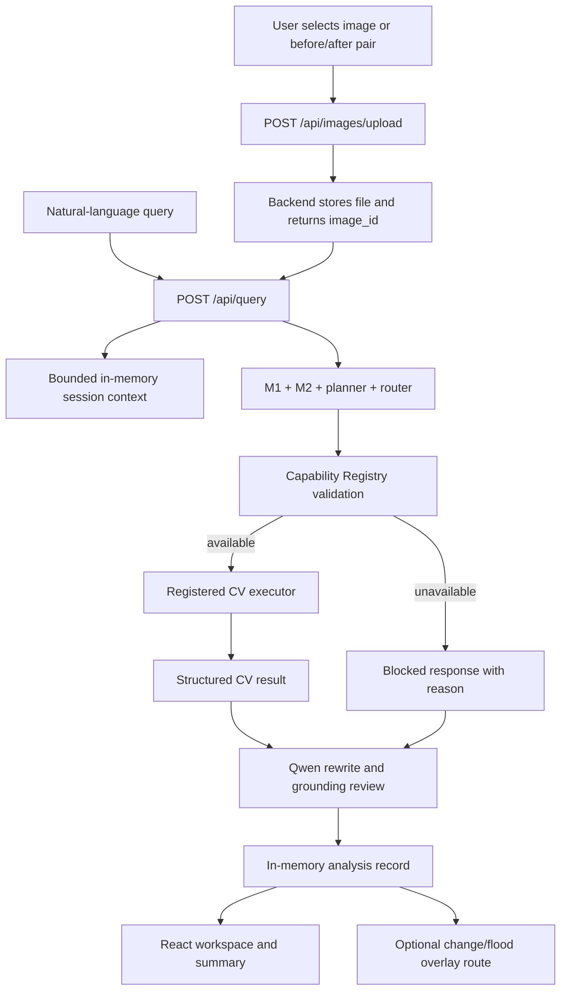

# System Architecture

## End-to-end flow

## Component responsibilities

### Frontend

React context/hooks retain selected image IDs and UI state. Chat requests use `frontend/src/services/chatApi.js` and the shared API client. The workspace uploads images, submits `/api/query`, and presents assistant responses and analysis details. Overlay URLs are served by the backend.

### FastAPI backend

`backend/main.py` defines upload, health, query, analysis, history, result, and overlay routes. Uploaded files are stored under `backend/storage/uploads/`. `backend/services/inference_service.py` calls the NLP pipeline, validates inputs such as flood SAR imagery, executes registered tasks, and assembles the result. Analysis history and conversation cache are process-local and not durable.

### NLP and routing

`nlp/pipeline.py` coordinates original-query M1 predictions, M2 decomposition, per-subquery M1 predictions, structured task planning, hybrid routing, and registry validation. CV executors run only after validation reports the requested task as ready.

### CV registry and executors

`cv/registry.py` registers callable executors only when implementation files and required artifacts are present. Model-specific inference lives in `cv/models/`; executors return structured JSON-compatible values and may save masks/overlays under the predictions output tree.

### Conversational response generation

`integration/response_generator.py` builds a deterministic answer from result fields. Qwen may rewrite it, followed by a structured factual-equivalence judgment. Rejected responses and request/parse errors use the deterministic draft. This review is model-based, not a formal proof.

## State and artifacts

- Input uploads are stored on disk by the backend.
- CV output artifacts are written under `cv/outputs/predictions/` or a task-specific directory passed beneath that root.
- Analysis records and session context live in process memory and are lost on restart.
- Checkpoints, datasets, and local M1 files are not included in normal Git tracking; missing required files make a capability unavailable.

## Deployment boundary

The application is configured for local development. The source does not implement user authentication or durable multi-worker session storage. Do not expose it publicly without separate access-control, persistence, and deployment work.
